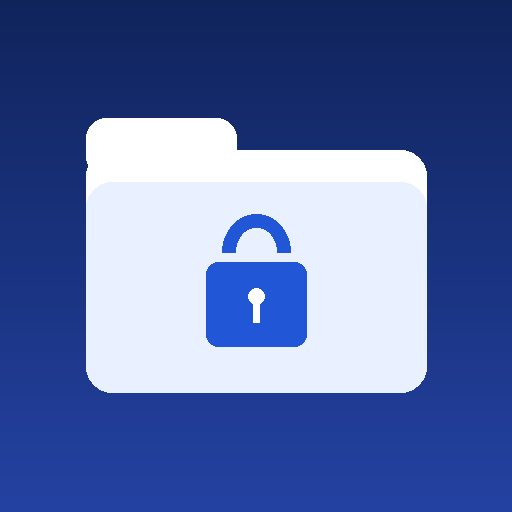

<div align="center">



# PS5NAS

**Convierte tu PS5 con jailbreak en un NAS multiusuario: SFTP, web, carpetas privadas cifradas y gestor de contraseñas compatible con Bitwarden, sin ningún PC encendido.**


</div>

---

## ✨ Qué hace

| | |
|---|---|
| 👥 **Multiusuario** | Cada usuario tiene su contraseña y solo ve las carpetas que le asignes (solo lectura o lectura y escritura). |
| 🔐 **SFTP** | Conexión cifrada (wolfSSH) desde *Mis archivos* de Samsung, WinSCP, FileZilla, Cyberduck… |
| 🌐 **Panel web** | Gestiona usuarios, carpetas y ajustes. Explorador con visor de fotos, vídeo, música, PDF y editor de texto. |
| 🔒 **Carpetas privadas cifradas** | Nombres y contenido cifrados en el disco (AES‑256‑GCM). El usuario no configura nada. |
| 🗝️ **Gestor de contraseñas** | Tu propio «Bitwarden» en la PS5: pestaña *Contraseñas* en la web y apps oficiales de Bitwarden (móvil con autorrelleno, extensión de navegador, escritorio). Importa el CSV de Google/Chrome/Firefox. |
| 🔏 **HTTPS propio** | La PS5 crea su certificado (IP de casa y de Tailscale); lo instalas una vez en cada dispositivo. |
| 🛡️ **Verificación en dos pasos** | Opcional para cada usuario: código de Google Authenticator, Aegis… en la web, las apps publicadas y Bitwarden. Contraseñas de aplicación para SFTP/FTP (Samsung, Windows, Linux). |
| 🔑 **Recuperar contraseñas** | Por correo (Gmail/SMTP con TLS) o pidiéndosela al administrador, que la acepta desde el panel. |
| 🧩 **Apps** | Pestaña con accesos directos a las otras webs de la consola (Machete IA, Tailscale…). El admin decide quién ve cada una. |
| 🌐 **Desde internet sin VPN** | Con un servidor gratis (Oracle Cloud) y DuckDNS: HTTPS de verdad y cada app en su propio subdominio tras iniciar sesión en PS5NAS. |
| 🌍 **Idiomas** | Español, inglés y alemán: la web y la app siguen el idioma del dispositivo y se pueden cambiar. |
| 📱 **Recordar sesión** | Entra directo desde la consola o el móvil durante 180 días. |
| 🎵 **Spotify** | Una playlist por mes con tus «Me gusta» y otra con lo más escuchado, automáticas. Organiza tu música en el USB y crea listas `.m3u8` por playlist. |
| 🛰️ **Fuera de casa** | Funciona con [Tailscale para PS5](https://github.com/holdmysocks/ps5-tailscale): la consola es el servidor y la VPN. |
| 🎮 **App en la pantalla de inicio** | Arranca el servidor, muestra las direcciones (también la IP de Tailscale) y abre el panel. |

```
 Móvil / portátil fuera de casa               PS5 (siempre encendida)
 ┌─────────────────────────────┐  Tailscale  ┌─────────────────────────────┐
 │ Navegador  →  http://ps5:8000│ ══════════► │ tailscale  (VPN)            │
 │ Mis archivos → SFTP ps5:2222 │ (WireGuard) │ PS5NAS: web :8000, SFTP :2222│
 └─────────────────────────────┘             │   usuarios → carpetas del SSD│
                                             └─────────────────────────────┘
```

## 🚀 Instalación rápida

1. Descarga `PPSA27360.zip` de la última [release](../../releases).
2. Copia la carpeta `PPSA27360` a `/data/homebrew/` (permisos `777`). Hace falta
   [ShadowMountPlus](https://github.com/drakmor/ShadowMountPlus) y un cargador de ELF en el puerto 9021.
3. Abre **PS5NAS** desde la pantalla de inicio: arranca el servidor y abre el panel.
4. Crea el administrador y los usuarios en `http://IP-DE-TU-PS5:8000`.
5. Conéctate por SFTP a `IP-DE-TU-PS5`, puerto `2222`, con tu usuario.
6. Contraseñas: pestaña **Contraseñas → Conectar apps** (servidor autoalojado `https://IP-DE-TU-PS5:8443`).

¿Prefieres sin app? Envía `ps5nas.elf` al puerto 9021.

## 📖 Documentación

Toda la guía (gestor de contraseñas y Bitwarden, Tailscale, correo de recuperación, carpetas cifradas, seguridad, compilación y formato de configuración) está en **[docs/GUIA.md](docs/GUIA.md)**.

## 🛠️ Compilar

```sh
export PS5_PAYLOAD_SDK=/opt/ps5-payload-sdk
./third_party/fetch.sh      # wolfSSL + wolfSSH
./tools/build-app.sh        # payload + app → dist/PPSA27360.zip
sh test/run_tests.sh        # pruebas en Linux
```

## 🙏 Créditos

El gestor de contraseñas es compatible con los clientes de [Bitwarden](https://bitwarden.com) (marca de Bitwarden Inc., sin relación con este proyecto); los formatos de la API se comprobaron con [Vaultwarden](https://github.com/dani-garcia/vaultwarden).
Basado en [ftpsrv](https://github.com/ps5-payload-dev/ftpsrv) de John Törnblom. Usa
[wolfSSL](https://github.com/wolfSSL/wolfssl), [wolfSSH](https://github.com/wolfSSL/wolfssh) y [cJSON](https://github.com/DaveGamble/cJSON),
y la plantilla [ps5-native-app-boilerplate](https://github.com/drakmor/ps5-native-app-boilerplate).

Licencia **GPLv3** — ver [LICENSE](LICENSE).
