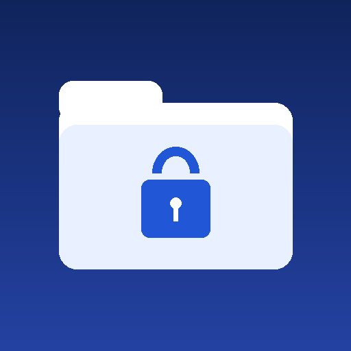

# PS5NAS



Servidor de archivos **multiusuario** que corre directamente en una PS5 con
jailbreak (antes se llamaba *PS5 Share*). Cada usuario tiene su contraseña y solo ve las carpetas que le
asignes, en **solo lectura** o **lectura y escritura**. Se gestiona desde una
**web** (usuarios, carpetas y ajustes) y se accede por **SFTP** (cifrado), desde
el propio navegador (explorador de archivos con subida y descarga) o, si lo
activas, por FTP clásico.

Incluye **carpetas privadas cifradas** (en el disco solo hay datos cifrados),
un **explorador web** que abre fotos, vídeos, música y PDF y edita archivos de
texto, **recuperación de contraseñas** (por correo o pidiéndosela al
administrador), **«recordar sesión en este dispositivo»** y una **app para la
pantalla de inicio** que arranca el servidor, enseña las direcciones (también la
IP de Tailscale) y abre el panel en el navegador de la consola.

Está pensado para funcionar junto a **Tailscale para PS5**, de modo que la
consola sea a la vez el servidor y el punto de acceso VPN, sin necesitar ningún
PC encendido.

Es un fork de [ftpsrv](https://github.com/ps5-payload-dev/ftpsrv) de John
Törnblom (GPLv3).

```
 Móvil / portátil fuera de casa                 PS5 (siempre encendida)
 ┌───────────────────────────┐   Tailscale    ┌──────────────────────────────┐
 │ Navegador → http://ps5:8000│ ═════════════► │ tailscale.elf  (VPN, :8090)  │
 │ Mis archivos → SFTP ps5:2222│  (WireGuard)  │   └► reenvía a 127.0.0.1     │
 └───────────────────────────┘                 │ ps5share.elf                 │
                                               │   web :8000 · SFTP :2222     │
 En casa: http://192.168.100.208:8000          │   usuarios → carpetas del SSD│
          sftp 192.168.100.208 puerto 2222     └──────────────────────────────┘
```

## Qué incluye

| | |
|---|---|
| `PPSA27360.zip` | La app **PS5NAS** para la pantalla de inicio (lleva dentro el servidor). |
| `ps5share.elf` | El payload para la PS5 (web + SFTP, y FTP opcional), por si lo prefieres sin app. |
| `windows/enviar-payload.ps1` | Envía cualquier `.elf` a la PS5 (puerto 9021). |
| `windows/instalar-tailscale-ps5.ps1` | Descarga la última versión de Tailscale para PS5 y la envía. |
| `windows/planB-windows-subnet-router.ps1` | Plan B si Tailscale no funciona en tu firmware: el Windows hace de puente. |

## Puesta en marcha

### 1. Instalar la app o cargar el payload

**Con la app (recomendado).** Hace falta
[ShadowMountPlus](https://github.com/drakmor/ShadowMountPlus) y un cargador de
ELF en el puerto 9021 (elfldr). Descomprime `PPSA27360.zip` y copia la carpeta
`PPSA27360` a `/data/homebrew/` (que quede `/data/homebrew/PPSA27360/eboot.bin`)
con todos los permisos en `777`. En unos segundos aparece **PS5NAS** en la
pantalla de inicio. Al abrirla:

1. si el servidor no está en marcha, lo arranca (envía su `ps5share.elf` al
   cargador);
2. abre el panel en el navegador de la PS5 (`http://127.0.0.1:8000`), donde
   inicias sesión con tu usuario;
3. muestra las direcciones para conectarse en casa y, si el payload de
   Tailscale está en marcha, su IP `100.x.y.z` para conectarse desde fuera.
   **X** vuelve a abrir el panel y **TRIÁNGULO** reinicia el servidor.

Marca **«Recordar sesión en este dispositivo»** al entrar desde la consola (ya
viene marcada en el navegador de la PS5) y la próxima vez entrarás directo,
aunque se reinicie el servidor. Dura 180 días o hasta que pulses **Salir**.

**Solo el payload.** Con el jailbreak y el cargador de ELF activos:

```powershell
cd windows
.\enviar-payload.ps1 -Archivo ..\ps5share.elf -PS5 192.168.100.208
```

En la PS5 aparecerá una notificación con las direcciones. La primera vez
genera las claves del servidor SFTP, así que puede tardar un poco más en
arrancar. ps5share no detiene ningún otro payload: si tienes el ftpsrv
original u otra app que lo lleve dentro (como Machete IA), siguen funcionando.

### 2. Crear el administrador y los usuarios

Abre `http://192.168.100.208:8000` en el PC o el móvil:

1. La primera vez te pide crear la cuenta de **administrador**.
2. En **Usuarios → Nuevo**: nombre, contraseña y las carpetas a las que tiene
   acceso. Para cada carpeta eliges el nombre que verá el usuario, la ruta real
   (botón **Elegir…** para navegar por el disco de la PS5) y el permiso.
3. Si tú también quieres ver archivos, añade carpetas a tu propio usuario.

Los cambios se aplican al momento: si desactivas o borras un usuario, sus
sesiones SFTP, FTP y web se cortan.

**Contraseñas propias.** En cada usuario puedes marcar:

* *Puede cambiar su propia contraseña*: puede cambiarla desde **Mi cuenta** en
  la web (también desde el navegador del móvil).
* *Obligarle a cambiarla al iniciar sesión*: la primera vez que entre en la web
  tendrá que poner una contraseña nueva antes de hacer nada más. Hasta que lo
  haga, no puede entrar por SFTP ni FTP (esos protocolos no tienen forma de
  pedir el cambio). Úsalo al dar de alta a alguien con una contraseña temporal.

Los usuarios creados con versiones anteriores tienen las dos opciones
desactivadas; actívalas en su ficha si quieres.

**Ver la contraseña de un usuario.** En su ficha, el ojo de *Contraseña
actual* la muestra. Las contraseñas se guardan cifradas con una clave de la
consola (`/data/ps5share/master.key`), no en claro. De los usuarios creados
con versiones anteriores solo se conoce la contraseña después de que vuelvan a
entrar una vez (por SFTP o por la web).

Rutas habituales del almacenamiento en la PS5: `/mnt/ext0` (SSD M.2 o
almacenamiento ampliado), `/mnt/usb0`, `/mnt/usb1` (discos USB), `/data`.

### 3. Acceso remoto con Tailscale en la PS5

Se usa [holdmysocks/ps5-tailscale](https://github.com/holdmysocks/ps5-tailscale),
que ejecuta Tailscale dentro de la PS5 (modo userspace) y publica en tu red
Tailscale los puertos TCP que estén escuchando en la consola.

```powershell
.\instalar-tailscale-ps5.ps1 -PS5 192.168.100.208
```

En la página de estado de Tailscale (`http://192.168.100.208:8090`):

1. Inicia sesión en tu cuenta de Tailscale.
2. **Pon una contraseña** a esa página.
3. En *Settings → TCP ports never exposed* añade **2121, 8080, 9021, 2323,
   3232**. Son ftpsrv (también el que llevan apps como Machete IA), websrv, el
   cargador de payloads, la shell y el log de otros payloads: ninguno pide
   contraseña y no deben quedar accesibles desde fuera. Ojo: Tailscale en la
   PS5 publica también los servicios que solo escuchan en `127.0.0.1`. Si no
   quieres que nadie más de tu tailnet use Machete IA, añade también **7860**.
4. Apunta la IP de Tailscale de la PS5 (`100.x.y.z`). Si activas el FTP,
   pégala también en **ps5share → Ajustes → IP de Tailscale** (solo la usa el
   FTP pasivo; SFTP no la necesita).

Desde cualquier dispositivo con Tailscale: web en `http://100.x.y.z:8000` (o
`http://ps5:8000` con MagicDNS) y SFTP en `100.x.y.z`, puerto `2222`.

### 4. Dar acceso a otras personas

1. Crea su usuario en ps5share con sus carpetas.
2. Esa persona instala Tailscale con su propia cuenta.
3. Desde la consola de Tailscale (*Machines → ps5 → Share*) compártele **solo
   el dispositivo ps5**. No ve el resto de tus equipos.
4. En la PS5 deja `allowFrom` en su valor por defecto (si lo pones en `"own"`
   los dispositivos compartidos quedan fuera).

Con los puertos bloqueados del paso 3, lo único que puede alcanzar es la web y
el FTP de ps5share, donde solo ve sus carpetas.

### 5. Que arranque solo

Los payloads se pierden al reiniciar la consola o salir del modo reposo sin
jailbreak. Puedes abrir la app PS5NAS después de cada jailbreak, o añadir
`tailscale.elf` y `ps5share.elf` (está dentro de la carpeta `assets` de la app)
a tu cargador automático
(el autoloader o gestor de payloads que uses) para que se carguen solos tras
cada jailbreak. La PS5 no atiende conexiones en modo reposo: tiene que estar
encendida.

## Recuperar contraseñas

En la pantalla de inicio de sesión hay **«¿Olvidaste tu contraseña?»**, con
dos formas (puedes activar una, las dos o ninguna en **Ajustes → Recuperar
contraseñas**):

* **Por correo.** El usuario escribe su nombre y su *correo de recuperación*;
  si coinciden, le llega un correo con su contraseña actual. El correo se pone
  en la ficha del usuario (los usuarios que ya tenías no tienen ninguno: añádelo
  tú) y él mismo puede cambiarlo en **Mi cuenta** (y ponerlo al cambiar su
  contraseña temporal). Por seguridad, la web responde siempre lo mismo, exista
  o no el usuario, y no envía más de un correo cada 2 minutos por usuario.
* **Pidiéndosela al administrador.** El usuario escribe su nombre y deja la
  página abierta. Al administrador le llega una notificación en la PS5 y la
  solicitud aparece en **Usuarios** (con un contador en la pestaña). Si la
  aceptas, el usuario ve su contraseña en su pantalla (una sola vez). Si su
  contraseña aún no se conoce, ponle una nueva antes de aceptar.

**Configurar el correo (Gmail).** Los correos salen de una cuenta de Gmail
tuya:

1. Activa la verificación en dos pasos en esa cuenta de Google.
2. Crea una **contraseña de aplicación** en
   <https://myaccount.google.com/apppasswords> (16 letras).
3. En **Ajustes → Recuperar contraseñas** escribe la cuenta de Gmail y esa
   contraseña, guarda y pulsa **Enviar correo de prueba**.

Servidor `smtp.gmail.com`, puerto 465 (TLS). Sirve cualquier otro proveedor:
puerto 465 para TLS directo o 587 para STARTTLS. Se comprueba el certificado del
servidor; la contraseña de correo se guarda cifrada.

## Ver y editar archivos en la web

En **Archivos**, pulsa un archivo para abrirlo: fotos (con anterior/siguiente),
vídeo, música y texto se ven en la propia página; los PDF se abren en una
pestaña nueva. Los archivos de texto (`.txt`, `.md`, `.json`, `.srt`, `.ini`,
código…) se pueden **editar y guardar** (Ctrl+S), y **Nuevo archivo** crea uno.
También puedes crear carpetas, renombrar, borrar, subir (o arrastrar) y
descargar. Todo funciona igual en las carpetas privadas cifradas y por SFTP.

## Apps: accesos a otras webs de la consola

La pestaña **Apps** reúne accesos directos a las demás webs que tengas en la PS5
(Machete IA en el 7860, Tailscale en el 8090, un gestor de descargas…) o en tu
red. El administrador las añade con **Añadir app**:

* **Destino:** un puerto, con ruta opcional (`7860`, `8090/ruta`), o una
  dirección completa (`http://192.168.1.10:8096`). Con un puerto, la app se abre
  en la misma dirección con la que se ha entrado a PS5NAS, así que funciona en
  casa, desde fuera por Tailscale y en el navegador de la consola.
* **Quién la ve:** todos los usuarios, o solo los que marques. Los
  administradores las ven todas. Si un usuario no tiene ninguna, no le aparece
  la pestaña.

Es solo un acceso directo: PS5NAS no protege esas webs. Si una app no tiene su
propia contraseña, cualquiera que llegue a ese puerto puede abrirla aunque no
la vea en su lista.

## Conectarse con SFTP

* Servidor: `192.168.100.208` en casa, o la IP `100.x.y.z` de Tailscale fuera.
* Puerto: **2222**. Usuario y contraseña: los que creaste en la web.
* La primera vez el cliente te enseña la **huella de la clave** del servidor:
  comprueba que coincide con la de **Ajustes** y acéptala. Si algún día te avisa
  de que la huella ha cambiado sin que hayas borrado las claves, no conectes.

**Samsung «Mis archivos»:** *Almacenamiento de red → Añadir almacenamiento de
red → SFTP*. Servidor, puerto 2222, usuario y contraseña. Con Tailscale
activado en el móvil funciona igual desde fuera de casa (usa la IP 100.x).

**PC:** WinSCP o FileZilla (protocolo SFTP, puerto 2222), o desde la terminal
`sftp -P 2222 usuario@192.168.100.208`.

Solo se permite SFTP: no hay shell, ni ejecución de comandos, ni reenvío de
puertos, aunque el usuario tenga contraseña válida.

### FTP (opcional)

Desactivado por defecto porque no cifra nada. Si algún cliente solo habla FTP,
actívalo en Ajustes: puerto **2121**, modo **pasivo**, puertos pasivos
50000–50099.

## Carpetas privadas cifradas

En la ficha de un usuario, elige **Privada cifrada** como permiso de una
carpeta. Desde ese momento:

* Todo lo que ese usuario guarde ahí (nombres de archivos y carpetas incluidos)
  se escribe cifrado en el disco. El administrador, otros usuarios o
  cualquiera que lea el disco de la PS5 solo ven nombres sin sentido y datos
  cifrados.
* El usuario no tiene que hacer nada distinto: entra por SFTP o por la web con
  su usuario y contraseña de siempre y lo ve todo normal.
* La clave se protege con **su contraseña**. Si él cambia su contraseña, o se
  la cambias tú, sus archivos siguen accesibles (la clave se vuelve a proteger
  con la nueva). La única excepción: un usuario de una versión anterior cuya
  contraseña aún no se conoce (no ha vuelto a entrar); si le pones otra antes,
  pierde lo que tuviera cifrado.
* **Ojo:** como el administrador puede ver las contraseñas, también podría
  entrar con la cuenta de ese usuario y ver su carpeta. El cifrado protege
  frente a quien lea el disco (por ejemplo, si te roban el SSD), frente a los
  demás usuarios y frente a mirar la carpeta desde otra cuenta.
* La carpeta tiene que ser nueva o estar vacía (si no existe se crea sola) y
  solo puede pertenecer a un usuario.
* Solo funciona por **SFTP y la web**. El FTP no la muestra.
* Limitaciones: se ve cuántos archivos hay y su tamaño aproximado; los nombres
  pueden tener como mucho 140 caracteres; quien controle la consola podría
  modificar el servidor para capturar contraseñas cuando se usen, así que
  protege de verdad lo que no sea solo «que no lo vea el admin» con su propia
  contraseña fuerte y sin compartirla.

Detalles técnicos: clave de datos de 256 bits por usuario, envuelta con
AES-256-GCM y una clave PBKDF2-SHA256 de su contraseña; contenido en bloques
de 64 KiB con AES-256-GCM (nonce aleatorio por bloque, clave propia por
archivo); nombres con SIV (HMAC-SHA256 + AES-256-CTR) en base32, válido
también en discos exFAT.

## Gestor de contraseñas (compatible con Bitwarden)

Cada usuario puede tener su propio **gestor de contraseñas** guardado en la
PS5. Se usa desde la pestaña **Contraseñas** de la web (también en el navegador
de la consola) y con las **apps oficiales y gratuitas de Bitwarden**: la app de
Android/iPhone (con autorrelleno), la extensión para Chrome, Edge, Firefox,
Brave, Opera y Safari, y la app de escritorio. La contraseña es **la misma de
PS5NAS**.

```
 Móvil / portátil                         PS5
 ┌──────────────────────────┐   HTTPS   ┌──────────────────────────────────┐
 │ App / extensión Bitwarden │ ════════► │ PS5NAS :8443 (certificado propio)│
 │  servidor «autoalojado»   │ Tailscale │   /data/ps5share/vault/<usuario>  │
 └──────────────────────────┘           └──────────────────────────────────┘
```

### Activarlo

1. **Ajustes → Gestor de contraseñas**: viene activado. Puedes elegir la
   **carpeta donde se guardan los datos** (botón *Elegir…*, p. ej. un disco
   USB o el SSD M.2); al cambiarla, los datos se mueven solos.
2. En la ficha de cada usuario marca **Gestor de contraseñas** (viene marcado
   en los usuarios nuevos y en el administrador inicial). Su gestor se crea al
   momento si se conoce su contraseña, o la próxima vez que entre en la web.
3. **Ajustes → HTTPS**: activado en el puerto **8443**. Si usas MagicDNS de
   Tailscale, añade el nombre (p. ej. `ps5.tu-red.ts.net`) en *Nombres extra
   para el certificado*.

Para **desactivarlo** para todos, quita *Activar el gestor de contraseñas* en
Ajustes (se aplica al momento y no se borra nada). Para un solo usuario, quita
la casilla de su ficha. El HTTPS también se activa, desactiva o cambia de
puerto al momento.

### Conectar las apps y la extensión

En la pestaña **Contraseñas → Conectar apps** cada usuario ve su servidor, su
correo de acceso y las instrucciones paso a paso:

1. **Instalar el certificado de la PS5** (una vez por dispositivo). Las apps de
   Bitwarden solo se conectan por HTTPS y la PS5 firma su propio certificado.
   Se descarga en `http://IP-DE-TU-PS5:8000/ps5nas-ca.crt` y se instala como
   *certificado de CA* (Android), perfil + «confianza total» (iPhone), en
   «Entidades de certificación raíz de confianza» (Windows) o en el llavero
   (Mac). Comprueba que la huella coincide con la de **Ajustes**.
2. En Bitwarden, en la pantalla de inicio de sesión, elige **Autoalojado** y
   pon como URL del servidor `https://IP-DE-TU-PS5:8443` (en casa) o
   `https://100.x.y.z:8443` (fuera de casa con Tailscale).
3. Entra con `usuario@ps5nas.local` (el dominio se cambia en Ajustes) y la
   contraseña de PS5NAS.

El certificado del servidor incluye la IP de casa, la de Tailscale y
`127.0.0.1`; si cambian, se vuelve a emitir solo y no hay que reinstalar nada.
Solo hay que reinstalar si pulsas **Crear una CA nueva**.

### Qué se puede hacer

* **Web:** buscar, filtrar por carpeta o tipo, favoritos, ver y copiar
  usuario/contraseña, generador de contraseñas, inicios de sesión, notas y
  tarjetas, papelera (restaurar o borrar para siempre), carpetas,
  **importar** el `.csv` que exportan Google (passwords.google.com), Chrome,
  Edge, Firefox o Bitwarden, y **exportar** a CSV (pide la contraseña).
* **Apps de Bitwarden:** todo lo anterior más autorrelleno, códigos TOTP,
  identidades, claves SSH y campos personalizados.
* No están disponibles: organizaciones/compartir, adjuntos, Bitwarden Send y
  verificación en dos pasos de la propia cuenta.

### Contraseñas y seguridad

* El contenido lo cifran las apps (AES-256 + HMAC, clave derivada con
  PBKDF2-SHA256 de 600 000 iteraciones). En el disco solo hay datos cifrados.
* Como la contraseña es la de PS5NAS, al cambiarla (en **Mi cuenta**, o el
  administrador en la ficha) la consola vuelve a proteger la clave del gestor
  con la nueva: no se pierde nada y las apps piden volver a entrar. Desde la
  app de Bitwarden no se puede cambiar la contraseña.
* Si el administrador obliga a cambiar la contraseña temporal, las apps no
  dejan entrar hasta que el usuario la cambie en la web.
* La web descifra en la consola (así funciona también sin HTTPS y en el
  navegador de la PS5), con una copia de la clave sellada con `master.key`.
  Igual que con las carpetas privadas: protege frente a quien lea el disco y
  frente a los demás usuarios, pero el administrador, que puede ver las
  contraseñas de PS5NAS, podría entrar con la cuenta de otro.
* Al borrar un usuario, su gestor se renombra a `<usuario>.json.borrado` en la
  carpeta de datos (por si fue un error).
* **No bloquees el puerto 8443** en Tailscale si quieres usar las apps fuera
  de casa.

## Seguridad

* Contraseñas comprobadas con PBKDF2-SHA256 (20 000 iteraciones, sal
  aleatoria). Además se guarda una copia cifrada (AES-256-GCM) con la clave de
  la consola `/data/ps5share/master.key`, para poder mostrársela al
  administrador y enviarla por correo. Quien tenga acceso a los archivos de la
  PS5 (jailbreak) puede descifrarlas: protege la consola.
* Sesiones recordadas en `/data/ps5share/sessions.conf` (solo el hash del
  token, no el token).
* Los usuarios no pueden salir de sus carpetas (ni con `..` ni con enlaces
  simbólicos) y no pueden borrar ni renombrar la carpeta raíz asignada.
* Web: cookie `HttpOnly` + `SameSite=Strict`, protección CSRF por cabecera,
  bloqueo temporal tras 10 intentos fallidos, los archivos se sirven en un
  *sandbox* para que un HTML subido no pueda ejecutar nada.
* SFTP: SSH con [wolfSSH](https://github.com/wolfSSL/wolfssh) y
  [wolfSSL](https://github.com/wolfSSL/wolfssl) (curve25519, ECDH, AES-GCM/CTR,
  HMAC-SHA2). Claves del servidor ECDSA P-256 y RSA 3072 generadas en la propia
  consola (`/data/ps5share/ssh_host_*.der`). Solo autenticación por contraseña,
  bloqueo tras 5 intentos por conexión.
* FTP (si lo activas): bloqueo tras 5 intentos por conexión, la conexión de
  datos solo se acepta desde la IP del cliente, sin `PORT` hacia terceros.
* **La web y el FTP van sin cifrar.** A través de Tailscale todo viaja cifrado
  por WireGuard; en tu red de casa, solo SFTP va cifrado. No abras puertos en
  el router.
* Por Tailscale todas las conexiones llegan a ps5share desde `127.0.0.1`, así
  que el bloqueo por intentos fallidos de la web se aplica a todos los
  accesos remotos a la vez.

## Plan B: Windows como puente

Solo si Tailscale no funciona en tu firmware (ps5-tailscale está probado en
13.42). ps5share sigue en la PS5; el Windows anuncia la IP de la consola a tu
red Tailscale:

```powershell
# PowerShell como administrador, con Tailscale para Windows instalado
.\planB-windows-subnet-router.ps1 -PS5 192.168.100.208
```

Después aprueba la ruta en la consola de Tailscale. Desde fuera usarás
`http://192.168.100.208:8000` y SFTP a `192.168.100.208`, puerto 2222. El Windows tiene
que estar encendido (y sin suspenderse).

## Compilar la app

La app nativa está en `app/` (basada en
[ps5-native-app-boilerplate](https://github.com/drakmor/ps5-native-app-boilerplate),
GPL-3.0-or-later). Requiere clang-18 y lld-18:

```sh
export PS5_PAYLOAD_SDK=/opt/ps5-payload-sdk
./tools/build-app.sh            # payload + app → dist/PPSA27360.zip (permisos 777)
```

## Compilar el payload

Con el [ps5-payload-sdk](https://github.com/ps5-payload-dev/sdk) en Linux o WSL:

```sh
./third_party/fetch.sh          # una vez: wolfSSL v5.9.4, wolfSSH v1.6.0 y cJSON v1.7.19
export PS5_PAYLOAD_SDK=/opt/ps5-payload-sdk
make -f Makefile.ps5            # genera ps5share.elf
make -f Makefile.ps5 test PS5_HOST=192.168.100.208   # compila y envía
```

Para probar en Linux sin consola:

```sh
./test/run_tests.sh             # compila la versión Linux y pasa ~240 pruebas
BW_CLI=$(which bw) ./test/run_tests.sh   # además con la CLI oficial de Bitwarden
./ps5share-linux -d ./datos     # web en :8000, SFTP en :2222
```

### Estructura

| Archivo | Qué hace |
|---|---|
| `src/config.c` | `users.conf`, usuarios, contraseñas (PBKDF2), ajustes |
| `src/vfs.c` | Carpetas virtuales por usuario y bloqueo de escapes |
| `src/sftp.c` | Servidor SFTP v3 sobre wolfSSH, con el mismo VFS y permisos |
| `src/crypt.c` | Carpetas privadas: claves, nombres y contenido cifrados |
| `src/smtp.c` | Envío de correos (SMTP con TLS de wolfSSL, CA raíz en `src/cacerts.h`) |
| `src/tsip.c` | Busca la IP de Tailscale de la consola (API del payload en `:8090`) |
| `tools/gen-icon.py` | Genera el icono de la app |
| `app/` | App de la pantalla de inicio (eboot.bin) |
| `src/ftp.c` | Servidor FTP (derivado de ftpsrv) con login y permisos |
| `third_party/` | Configuración de wolfSSL/wolfSSH y script de descarga |
| `src/http.c` | Servidor web (HTTP y HTTPS) y API JSON |
| `src/tls.c` | CA propia de la consola, certificado del servidor y TLS |
| `src/vault.c` | API compatible con Bitwarden (inicio de sesión, sincronización, elementos) |
| `src/vaultweb.c` | Pestaña «Contraseñas» de la web (cifra y descifra en la consola) |
| `src/bwcrypto.c` | Criptografía de Bitwarden: PBKDF2, HKDF, AES-CBC+HMAC, RSA, JWT |
| `web/index.html` | Interfaz web (se incrusta en el ELF con `tools/embed.py`) |
| `src/main-prospero.c` | Arranque en PS5 |

### Formato de `users.conf`

Separado por tabuladores. Mejor editarlo desde la web. En las líneas `user`
tras el hash van *administrador*, *activa*, *puede cambiar su contraseña* y
*debe cambiarla* (1 = sí).

```
set	ftp_port	2121
set	http_port	8000
set	pasv_min	50000
set	pasv_max	50099
set	pasv_address	100.101.102.103
set	sftp_port	2222
set	sftp_enabled	1
set	ftp_enabled	0
user	ana	<sal>	<hash>	1	1	1	0
mount	ana	rw	Fotos	/mnt/ext0/Fotos
mount	ana	ro	Películas	/mnt/usb0/Peliculas
mount	ana	enc	Privado	/mnt/ext0/privado/ana
ukey	ana	<sal>	<clave de datos envuelta>
pw	ana	<contraseña cifrada con master.key>
email	ana	ana@example.com
```

El gestor usa `vault_enabled`, `vault_dir` (vacía = `/data/ps5share/vault`),
`vault_domain`, `https_enabled`, `https_port` y `tls_names`, y una línea
`vault	<usuario>` por cada usuario con gestor. La CA y el certificado están en
`/data/ps5share/tls/`.

Los ajustes de correo son `smtp_host`, `smtp_port`, `smtp_user`, `smtp_pass`
(cifrada), `smtp_from_name`, `recover_email` y `recover_admin`.

Si olvidas la contraseña del administrador y no tienes correo de recuperación
ni otro administrador: carga el ftpsrv original, borra
`/data/ps5share/users.conf` (o solo las líneas de ese usuario) y vuelve a
cargar ps5share. Si no queda ningún usuario, la web vuelve a pedir que crees el
administrador.

## Licencia

GPLv3 (ver `LICENSE`). Basado en ftpsrv © John Törnblom. Incluye wolfSSL y
wolfSSH (GPLv3) © wolfSSL Inc.
